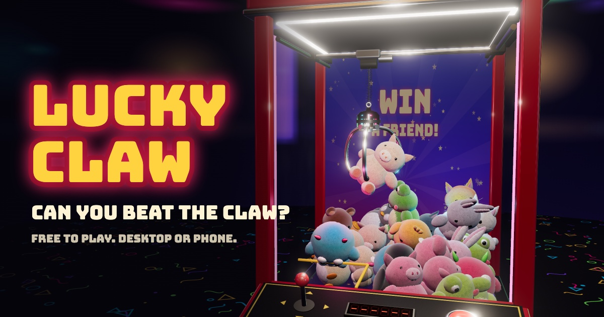

# Lucky Claw

**[Play it now](https://ghought.github.io/lucky-claw/)**

A realistic 3D arcade claw machine for the browser, on desktop and phone.



The claw isn't scripted. Each finger is a physics body on a hinge, closed by a
torque-limited motor, so a toy stays in the claw only through real contact and
friction. It can slip, swing loose, drag a neighbour up with it, or get knocked
into the chute by accident.

## Run it

```bash
npm install
npm run dev
```

`npm run dev` also prints a network URL. Open that on a phone on the same Wi-Fi.

| Command | What it does |
| --- | --- |
| `npm run build` | Production build in `dist/`, ready for any static host |
| `npm run build:single` | The whole game as one HTML file in `dist-single/` |
| `npm run sim [plays] [carry]` | Plays the machine headlessly and reports win rates |

Pushing to `main` deploys to GitHub Pages through
[.github/workflows/deploy.yml](.github/workflows/deploy.yml).
`node scripts/make-icons.mjs` regenerates the icons in `public/`.

## Controls

| | Desktop | Phone |
| --- | --- | --- |
| Move | Arrow keys or WASD (gamepads work too) | Left joystick |
| Insert coin, drop | Space or Enter | Round button |
| Look around | Drag the scene, or V for side view | Drag the scene, or Side view |
| Sound | M | Sound button |

## How the machine works

- **Grip:** full strength while closing, then it bleeds off on the way up, as on
  a real voltage-stepped claw. Each play rolls a carry strength, and the odds
  rise after a run of losses, like a real payout setting.
- **Slack cable:** the head sinks into the pile until the load on the fingers
  reaches `CLAW.slackForce`, then stops.
- **Swing:** the head is a damped pendulum driven by the gantry's acceleration,
  so stopping hard makes it swing.

Tune the feel in [src/sim/config.ts](src/sim/config.ts). `GRIP.carryMin` and
`GRIP.carryMax` are the payout dial. Run `npm run sim` afterwards to see the
effect.

## Layout

- `src/sim/` is the machine itself: physics, claw states and prize tracking. It
  has no DOM dependency, which is why `npm run sim` works in Node.
- `src/render/` is everything visual. All models and textures are generated in
  code, so there are no art files.
- `src/audio.ts` synthesises every sound with Web Audio.
- `src/ui.ts` is the on-screen controls and readouts.

Built with [Three.js](https://threejs.org) and [Rapier](https://rapier.rs).
Requires WebGL2.
